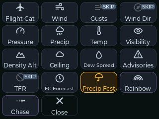

# MetarMap2 Copilot

**MetarMap2 Copilot** is the touchscreen of [MetarMap2](https://github.com/dman776/metarmap2): firmware for a 2.8"
ESP32-S3 touch display that sits beside the Chart (the map on the wall) and works like a small version of MetarMap2
Cockpit (the Chart's `/remote` page). Pick the visualizer, see what the pixels mean, set the pixels' brightness, turn
auto-rotate on or off and choose which visualizers it skips, and find an airport's pixel or hear its weather.

The Chart stays in charge. The Copilot reads the Chart's state over its HTTP API and
sends it the same controls the Cockpit does; it never fetches weather or
drives pixels itself.

| Chart | Airports | An airport's card |
|---|---|---|
|  |  |  |
| **Brightness** | **Splash** | **Update** |
|  |  |  |
| **Visualizer picker** | | |
|  | | |

## What it does

Everything is a tap, with big targets and as little scrolling as possible. A rail down the left side has three
buttons: **Chart**, **Airports**, and the **logo**.

**Chart**

- The running visualizer, big, with ◀ and ▶ either side to step through them. It follows the Chart when something
  else changes the visualizer (auto-rotate, the web UI, Home Assistant). A name too long for the header shows its
  short name instead ("FC Forecast").
- Tap the visualizer for the **picker**: every visualizer at once, a tile each with its icon and short name
  ("Density Alt"), the running one lit; tap one to switch the Chart to it, or **Close**. Rainbow and Chase, which
  take the whole strip, have a purple border.
- **Press and hold** a tile (about half a second) to leave that visualizer out of auto-rotate, and hold it again to
  put it back, as on the Cockpit. A skipped visualizer's icon is dimmed, with a small **SKIP** badge; a tap still
  switches the Chart to it, and the hold doesn't. The mark and a pop (high to skip, low to put back; with **Sounds**
  on) are all a hold that works shows; a message at the bottom shows for a moment only when something's wrong.
  Rainbow and Chase are always left out ("Rainbow: always left out"), and the last visualizer still in rotation
  can't be skipped ("Can't skip the last one in rotation"). The skip list is the Chart's (Config > Visualizers), so
  a change made there or on the Cockpit shows here within a couple of seconds; the Copilot keeps none of it. Needs a
  Chart newer than 26.11.10; with an older one there are no marks, and a hold says "Update the Chart to skip
  visualizers". Hold several quickly and each keeps its mark until the Chart answers. If the Chart doesn't answer
  within 30 s (the Wi-Fi went), the mark is undone ("Couldn't change Wind"), and a hold still waiting to be sent
  after 20 s is dropped rather than done later. The messages show only while the picker is open.
- **Flight Category Forecast** and **Precipitation Forecast** step every airport through Now, +3h, +6h and +12h, so a
  row of four chips under the name shows which step the Chart is on, the current one lit. The row only appears for a visualizer that steps
  (needs a Chart newer than 26.11.08); with an older one it's left out.
- The legend, showing only the entries the Chart is showing now: if every
  airport is VFR, just VFR (plus lightning or missing reports, if any). It
  appears once the Chart has switched, never unfiltered.
- An entry a row, its whole label (a long one wraps onto a second line). When
  they don't all fit, the list glides slowly down to the last entry, rests 2 s,
  glides back up, rests, and so on. Scroll it with a finger to read it your own
  way; 10 s after you let go it starts gliding again from there.
- Along the bottom: **Auto** (auto-rotate on or off, lit while on, counting down
  to the next visualizer) and **Pixels**, the brightness, which opens a sheet: a
  slider, - and + (5% a press), and 10%, 25%, 50% and 100%.

**Airports**

- A tile for every airport, with its flight category's color, in alphabetical
  order, twelve to a page. Swipe left or right for the next or previous page, or
  tap the strip under the tiles: a button for each page, named for its first
  airport (with more pages than fit, ◀ "3 / 9" ▶).
- A tap on an airport pulses its pixel white and opens its **card**: its code,
  flight category and name, its METAR, and three big buttons: **Locate** (pulse
  it again), **AWOS** (read its METAR aloud) and **ATIS** (its real ATIS, where it
  publishes one). While one plays its button is **Stop**. Closing the card (✕, or
  a tap beside it) stops it. For 2 s after a locate (opening the card, or
  **Locate**) the card says "Pixel pulsing on the Chart", while the pixel pulses.
- A tile also flashes, on its page, when the Chart pulses it from anywhere.
- While Rainbow or Chase runs, the tiles are dimmed and the card says locating
  is paused.

**The logo**

- Its dot is the Chart's connection: green, or red while the Chart doesn't answer
  (and the screen dims). A yellow star on it: a firmware update.
- A tap shows the splash screen with the versions and the Chart's address, two
  buttons: **Close**, and **Firmware** (**Update v...** when there's one), the
  firmware update screen, and a speaker button at the top right for the volume
  (see **Splash screen**). It closes on its own after 30 s.

**Status light**

- The board's RGB light on the back glows on the wall behind the Copilot, so you
  can tell its state from across the room:
  - **blue**, blinking while it joins the Wi-Fi, then steady if it can't (the
    splash says "Can't join" at the same moment);
  - **green** once it reaches the Chart, fading out after 10 s: dark while all
    is well;
  - **red** when the Chart stops answering (Wi-Fi still up), at the same moment
    the screen goes back to the splash (5 s);
  - **purple**, breathing slowly, in Wi-Fi setup;
  - **yellow**, blinking, while a firmware update installs.
- Its brightness is on the web page's Settings (5% at first; 0 turns it off).

**Web page**

- The Copilot serves its own page at **http://metarmap-copilot.local/** (or its
  IP, which the logo's splash shows as "Settings: http://..."). Log in as
  **metar** with the password **map**, the same defaults as MetarMap2
  Web, and change the password on the page (or set `WEB_PASSWORD` in
  `secrets.h`). The page says so while it's still `map`.
- **Screen**: the Copilot's screen as a PNG, refreshed on demand or live (about
  once a second), and **Download PNG**.
- **Firmware**: the installed and available versions, the update channel and
  branch, **Check now** and **Install**, with its progress.
- **Settings**: the Wi-Fi network and password, and the Chart's address and port;
  saving restarts the Copilot with them. If it can't join the new network, use
  **Wi-Fi setup** on its screen (below). A USB build's `secrets.h` applies only
  when it changes, so what you save on the page stays.
  Also the **status light**'s brightness (0-100%, 0 for off), and **Sounds** (on at first): the chime and the
  pops (the picker's, the volume slider's), off for silence (the touch tick and the spoken weather stay). Both take effect at once and stay
  through restarts and firmware updates.
- **Log**: the last 32 KB of the Copilot's log (what the serial console shows,
  each line with the seconds since startup), following new lines as they come,
  and **Download**.
- The log starts with why the last run ended: `last run ended: task watchdog (reset reason 6)` (power-on,
  software restart, panic, task watchdog, brownout, ...). After a crash it also shows the crash, once (it's
  then cleared from flash, which adds a fraction of a second to that one startup): `last crash: task
  stream_net, PC 0x..., cause ..., ELF sha256 ...` and `last crash: backtrace 0x... 0x...` (up to 16 frames).
  A crash dump that can't be read is cleared too (`unreadable crash dump ..., erased`). The addresses can be
  given to `addr2line` with the `firmware.elf` of the same build: `xtensa-esp32s3-elf-addr2line -pfiaC -e
  .pio/build/es3c28p/firmware.elf 0x... 0x...` (the toolchain is in
  `~/.platformio/packages/toolchain-xtensa-esp32s3/bin`). That names the crashing code for a crash in our code;
  for a task watchdog it may not: the watchdog's interrupt aborts, so the PC and the first frames are the
  panic, abort and interrupt handlers, and the code that was spinning shows deeper in the backtrace, if it's
  within the 16 frames at all. A task watchdog reads `PC ..., cause 29, address 0x00000000` (abort's deliberate
  write to address 0) with `panic_abort`, `esp_system_abort`, `abort` and `task_wdt_isr` as the first frames.
- The dump stays in flash until a firmware that reads it starts, so it can be from **before an update** (a firmware
  without these `last crash` lines never cleared it): the line ends `(this firmware)` or `(an earlier firmware, not this
  one)`, by its ELF sha256. Decode an earlier one with that build's ELF: a release's or branch build's
  `metarmap_remote-es3c28p.bin` holds its ELF sha256 (the app description at offset 32: bytes 144-175), and a
  local build of the same commit (without a `secrets.h`, as CI builds) has the same addresses even though its own
  sha256 differs. After an update `last run ended` says `software restart`: the restart into the new firmware, not
  the crash.
- Also in the log, each with its time: settings written to flash (`settings: saved the volume (12 ms)`, only when
  a value changed), Wi-Fi (`wifi: got 192.168.x.x`, `wifi: disconnected (reason N)` once per reason in a row,
  `wifi: lost the IP address`), and the speaker (`stream: speaking KIAH's ATIS`, `stream: play; free internal heap
  ..., N older readers closing`, `stream: stop; free internal heap ...`). An older reader still closing holds its
  stack for a moment, so the heap at `play` is lower then than once it has gone.
- Live control of the Chart stays on the touchscreen, MetarMap2 Web and the Cockpit.
- The page works through the Copilot's own endpoints (all behind the same login), listed in
  `src/remote_web.h`: `GET /api/state` (the versions, settings, `led`, `sounds` and the update's state), and
  `POST /api/connection`, `/api/channel`, `/api/check`, `/api/install`, `/api/password`, `/api/led`
  (`brightness=0`-`100`) and `/api/sounds` (`on=1` or `0`).

**Wi-Fi setup**

- A Copilot that isn't set up yet (the published firmware, or a build without
  `secrets.h`) opens its own open Wi-Fi network, **MetarMap2-Copilot-** and four
  letters from the board (e.g. `MetarMap2-Copilot-8160`), and shows how to join
  it: the name, and a QR code a phone's camera scans to join.
- On the phone, the setup page opens by itself (a captive portal, like a hotel's
  Wi-Fi), or go to **http://192.168.4.1/**. Pick your Wi-Fi from the networks
  the Copilot can see (2.4 GHz only), or **Other network...** for a hidden one,
  enter its password, and the Chart's address (`metarmap.local` unless you gave
  the Pi another hostname) and port. **Save and connect** restarts the Copilot
  on your Wi-Fi. No login here: it's your phone on the Copilot's own network.
- A Copilot that was set up but can't join its Wi-Fi any more (a new router, a
  changed password) shows **Wi-Fi setup** on its splash once it says "Can't
  join" or "Can't find". The same network and page come up; meanwhile, while no
  phone is joined, it keeps trying the saved Wi-Fi and closes Wi-Fi setup if
  that comes back (a router restarting). **Cancel**, or 10 minutes with no
  phone, also closes it.

**Splash screen**

- At startup: the MetarMap2 logo, the metarmap2 repo, the Copilot's firmware
  version and the Chart's (once it answers: v26.11.04, or v26.11.04+16 f86daa4
  when the Chart runs commits after a release), and
  "Connecting to Wi-Fi..." and "Connecting to the Chart..." turning OK. Two
  seconds after both are OK, the Copilot fades in.
- If Wi-Fi hasn't joined after 15 s, it names the network: "Can't find
  *network*" (out of range, or 5 GHz only) or "Can't join *network*", and keeps
  trying. The Chart's line says "retrying" while the Chart doesn't answer.
- If the Chart stops answering (or Wi-Fi drops) for 5 s, the Copilot goes back to it:
  "Reconnecting to the Chart... retrying" until the Chart answers, then the Copilot fades
  back in. Not while the update screen is open.
- A slow Chart (a Pi Zero busy sending an ATIS, say) is waited for without holding up the Copilot: each poll
  waits up to 5 s for it to answer and 5 s between parts of the answer, then counts as no answer. (Before, a
  Chart that stalled mid-answer could restart the Copilot.)
- The logo's splash (not the one at startup) has a speaker button at its top
  right: the speaker's volume. Its symbol shows the level, crossed out (muted) at
  0%. A tap opens a volume slider across the top of the screen, the same volume
  as the airport card's slider; letting go plays a short pop at the new level
  (none at 0%, with **Sounds** off, or while audio plays). A tap beside the
  slider, or 4 s without a touch, closes it; using it keeps the splash open
  another 30 s.

**Firmware updates**

- The Copilot checks GitHub for new firmware at startup and every 6 hours. When
  there is some, a yellow star appears on the logo.
- The logo's splash screen has **Update v...** (or **Firmware**) for the update
  screen: the installed and available versions, the update channel, and
  **UPDATE**, which downloads the new firmware, checks it, installs it and
  restarts.
- The channels are metarmap2's: **Releases** (the newest release, if newer than
  the installed one), **Latest commit** (the newest commit of `main`) and
  **Branch** (the newest commit of the branch you pick). The choice is saved.

**Volume**

- While the speaker plays, the airport's card has a volume slider above its
  buttons: heard at once, and kept through restarts. It hides when the audio
  stops.
- Any time, the logo's splash has the same volume on its speaker button (top
  right): a tap opens a slider, heard at once and kept through restarts, with a
  short pop at the new level when you let go. Slide it to 0% to mute: the
  button shows a muted speaker. The two sliders follow each other. The volume
  is for everything the speaker plays: the spoken weather, the radio, the
  chime and the pops (not the touch tick).

**Spoken weather**

- **AWOS** on an airport's card reads its METAR through the speaker, as an AWOS
  reads it. It plays once, the card saying "Getting the
  AWOS..." and then "Playing the AWOS".
- AWOS and ATIS work only while the Chart can speak (`/api/live`'s `speech`); with
  speech off at the Chart, or no server set, they're dimmed. They follow the Chart
  within a couple of seconds of the switch.
- The words come from the Chart: metarmap2 newer than 26.11.07, with **Enable
  speech** on in its **Config > System > Spoken weather** and a speech server
  set there (Piper in Home Assistant, or Kokoro). The Copilot plays the Chart's
  `/api/speak/<code>.audio`, a WAV, as it is (no decoding), resampled to
  16 kHz. The Chart makes the clip before answering, so the first time can take
  a few seconds; it keeps it until the next METAR.
- If the Chart can't, the Copilot shows why, in the Chart's words (e.g. spoken
  weather is off, or the speech server can't be reached).
- A Chart that is slow to answer, or never does, ends in "no answer" on the card (after 2 minutes, or at once if
  it closes the connection) instead of restarting the Copilot. **Stop**, closing the card, or another AWOS or
  ATIS ends the wait at once.
- While it's being got or playing, the button that started it says **Stop** (with the stop symbol), and a press
  stops it. A press counts once: a second press of the same button within 0.7 s is taken for the same touch, so a
  finger the touch screen loses for a moment can't stop and start it again. If older requests to a slow Chart are
  still closing, a new one waits a moment for them (the card says to try again if they don't close).
- Always from the Copilot's Chart (`MAP_HOST`).

**Spoken ATIS**

- With **Spoken ATIS** on at the Chart (Config > System > Spoken weather), the
  card's **ATIS** reads an airport's ATIS aloud where it publishes a digital one
  (about 75 large US airports; dimmed for the others): the information letter,
  the runways and approaches in use, the NOTAMs.
- **Read along**: once the sound starts, the card's METAR gives way to the ATIS
  line by line in the FAA's text, with the line being said lit, the others
  dimmed, and it kept in view. The Chart sends the lines (`/api/atis/<code>/lines`); the
  Copilot knows how far into the audio it is from the WAV's length, so the
  highlight follows the voice closely. Tap the text to stop; after the end it
  stays to read, and a tap goes back to the METAR.
- The Chart makes the whole ATIS before answering, about half a minute on a
  Kokoro server, so "Getting the ATIS..." shows until it starts; the Copilot
  waits up to 2 minutes (then the card says "no answer"; Stop ends the wait). Once made, the Chart keeps it
  until the ATIS changes.
- Needs metarmap2 with spoken ATIS (after 26.11.07). How a word is said is set
  on MetarMap2 Web's Pronunciation page.

**Everywhere**

- A short tick from the speaker on each touch: one per touch (not again within 0.12 s), as the finger lands.
- A two-second airplane chime when it reaches the Chart (not again within a minute, so a flaky Wi-Fi doesn't
  ring on and on), and a short high pop when you hold a visualizer to leave it out of auto-rotate, a low pop when you
  hold it to put it back, and one when you let go of the splash's volume slider. They play at the speaker's volume
  (the slider), and not while the radio plays. **Sounds**
  on the web page's Settings turns them off (the tick and the spoken weather stay); a tick during one is mixed in.
- A touch has to move 16 px before it scrolls rather than taps, so a finger
  that drifts a little still taps.
- Like the Cockpit, a control you just touched keeps your setting for
  3 s while the Chart catches up.
- The visualizers' icons and short names come from the Chart (metarmap2 after
  26.11.08); with an older Chart the picker shows each visualizer's name, without
  an icon.

The Cockpit's Map tab (the live map needs a browser), the visualizer's
description and the Micro switch are left out.

## Hardware

An LCDwiki **ES3C28P** ([wiki](https://www.lcdwiki.com/2.8inch_ESP32-S3_Display)):

- ESP32-S3 (N16R8): 16 MB flash, 8 MB PSRAM, Wi-Fi (2.4 GHz only)
- 2.8" ILI9341V 320×240 LCD, used in landscape with the USB-C port on the right
- FT6336G capacitive touch
- ES8311 audio codec and FM8002E amplifier, for a small speaker (up to 2 W
  into 4 Ω, per the wiki) on the 2-pin 1.25 mm speaker socket. It's optional:
  without one the Copilot is just silent

Power it from USB-C. The pin map is in
[include/board_es3c28p.h](include/board_es3c28p.h).

### Bezel

A bezel you can print on your own 3D printer holds the screen in your Chart:
[bezel/Metarmap Remote es3c28p_bezel_and_frame.3mf](bezel/Metarmap%20Remote%20es3c28p_bezel_and_frame.3mf)
for the ES3C28P. It's a Bambu Studio / OrcaSlicer project with two parts, a
black bezel and a yellow logo, so it prints in two colors (or in one, if you
leave the logo out). The project is sliced for a Flashforge AD5X with 0.2 mm
layers, 4 walls and 15% infill; pick your own printer and filament in the
slicer and slice it again.

## Install

The quickest way, with only Python 3 and a USB-C data cable: plug the board in
and run [`install.py`](install.py) (download that one file, or use a clone):

```sh
python3 install.py              # the newest release
python3 install.py --latest     # the newest build of the main branch
```

It downloads the release's factory image, checks its checksum, and flashes it
with esptool (yours if it's installed, or one it sets up for itself and then
removes). If it can't reach the board it shows the BOOT + RESET steps and tries
again. The Copilot then starts in **Wi-Fi setup**: join the network it names from
your phone and pick your Wi-Fi (see *Wi-Fi setup*). Other options:
`--port PORT`, `--file FILE` (a factory.bin you built), `--yes`.

Releases from v26.11.08 on have a factory image; `install.py` skips older ones.

To change the code, or build it yourself, use Setup below.

## Setup

You need [PlatformIO](https://platformio.org/) (the VS Code extension or
`pip install platformio`) and a MetarMap2 Chart on your network.

1. Optional: copy `include/secrets.example.h` to `include/secrets.h` and fill
   it in: your Wi-Fi network and password, and the Chart's address and port
   (`metarmap.local` or its IP; port `80` unless you changed
   `web_server.port`). `secrets.h` is git-ignored. The Copilot saves these in
   its flash the first time it starts with them, so they stay through firmware
   updates, which don't have them. Without `secrets.h`, the Copilot starts in
   **Wi-Fi setup** (above) and you set it up from your phone.
2. Connect the board by USB-C. It shows up as a serial port
   (`/dev/cu.usbmodem*` on macOS); no driver is needed.
3. Build and flash:

   ```sh
   pio run -t upload
   pio device monitor        # optional: the serial console
   ```

If the upload can't find the board, hold **BOOT**, tap **RESET**, release
**BOOT**, and upload again.

### Flashing a factory image yourself

`install.py` does this for you. Each release (and each branch build) has
`metarmap_remote-es3c28p-factory.bin`: the whole flash in one file (the
bootloader, the partition table and the firmware, which `pio run` also writes
to `.pio/build/es3c28p/factory.bin`). With
[esptool](https://github.com/espressif/esptool) (`pip install esptool`):

```sh
esptool --chip esp32s3 write-flash 0x0 metarmap_remote-es3c28p-factory.bin
```

(esptool before 5 spells it `esptool.py ... write_flash`.)

It also clears the board's saved settings, so the Copilot starts in **Wi-Fi
setup** and you set it up from your phone. To update a board that's already
set up, use its update screen (or `pio run -t upload`), which keeps them.

**A `factory.bin` you build yourself contains your `include/secrets.h`**: your
Wi-Fi password, the Chart's address and `WEB_PASSWORD`, if you set them. A board
flashed with it joins your Wi-Fi at once instead of starting in Wi-Fi setup, and
the file mustn't be shared. The ones attached to the GitHub releases are built
by GitHub without a `secrets.h`. To build one without yours, move
`include/secrets.h` aside first.

## Network and security

The Copilot only uses the Chart's endpoints that need no login: `/api/live`,
`/api/status`, `/visualizer/...`, `/brightness/...`, `/locate/...`, and
`/api/speak/...` and `/api/atis/...` for the spoken weather. It doesn't know
the Chart's username and password and can't change its saved configuration,
except the two auto-rotate settings those endpoints save: whether it's on
(`/visualizer/auto_rotate/on`, `/off`) and which visualizers it skips
(`/visualizer/<id>/skip`, `/unskip`).

Keep the Chart and the Copilot on a trusted local network, and don't expose the
Chart's web server to the internet. The Wi-Fi password is stored in the board's
flash, so treat the board like any device that knows it.

Firmware updates come only from this repo's GitHub releases, over HTTPS: the
Copilot trusts just the root certificates GitHub's API and downloads use
(`src/github_roots.h`), and checks each download against the SHA-256 GitHub
gives for it before switching to it. The published firmware has no Wi-Fi
settings in it.

The Wi-Fi setup network is open and its page has no login, as anyone setting it
up has to be at the Copilot: it comes up only on a Copilot that isn't set up yet,
or from a tap on the Copilot's own screen, and closes after 10 minutes with
nobody joined.

## How it works

A background task on the ESP32's second core polls `/api/live` every 1.5 s
and `/api/status` every minute, and again whenever the visualizer changes (for
its legend), the same split the `/remote` page uses. The touch screen runs on
the other core, so a slow answer never freezes it. Controls are queued to the
background task and the next `/api/live` shows their result. A skip from the
picker is marked at once; the Chart's answer (`{"id", "skipped", "skip"}`, or a
400 with a `reason`) then sets the marks (and, for a 400 or a failure, the
message; a skip that worked has none), and after that
`/api/live`'s `visualizer.autoRotate.skip` keeps them up to date. Each skip
command has a number its answer carries back, so an answer ends its own hold
and the marks of holds still waiting stay on top of the Chart's list
(`src/skips.cpp`, unit tested). A skip still queued after 20 s (a Wi-Fi outage)
is answered as failed instead of sent.

Firmware updates use the board's two firmware slots: the new firmware goes
into the spare one while the running one carries on, and the board switches
only after the whole file has arrived and matched its checksum. A failed or
interrupted download leaves the running firmware as it was. (The board's
bootloader can't roll back on its own, so if new firmware didn't start at all,
flash it by USB.)

Which legend entries are in use comes from the Chart: `/api/live`'s
`visualizer.legendInUse` names them by the `key` each entry has in
`/api/status`. The Chart knows exactly what each pixel shows (an estimated MVFR is
MVFR and Estimated; light snow is Snow and Light). The Copilot always filters,
whatever the Chart's own "Only show legend items in use" setting is.

A Chart from before `legendInUse` doesn't say, so the Copilot works it out from
each pixel's current look in `/api/live`: its effect and color (so blinking red
isn't solid red), a color along a gradient entry (temperature, pressure), the
lightning flag for the flash entry, else the nearest entry with the same
effect.

See the [MetarMap2 API documentation](https://github.com/dman776/metarmap2/blob/master/API.md)
for the endpoints.

| File | What it does |
|---|---|
| `src/main.cpp` | Setup, Wi-Fi, the main loop, serial commands |
| `src/remote_web.cpp`, `src/remote_web_page.h` | The Copilot's own web page: settings, firmware, the log, screenshots |
| `src/log.cpp`, `src/log_ring.cpp` | Logging to serial and the last 32 KB kept for the web page |
| `src/png.cpp` | Screenshots as PNG (compressed by the ESP32-S3 ROM's deflate on the board) |
| `src/wifi_setup.cpp`, `src/remote_setup_page.h` | Wi-Fi setup: the Copilot's own network, the captive portal, the setup page |
| `src/wifi_setup_text.cpp` | Wi-Fi setup's network name, QR code text and network list |
| `src/ui.cpp` | The screens (LVGL) |
| `src/status_led.cpp` | The status light on the back: its color for what the Copilot is doing |
| `src/timing.h` | Timings the screens and the status light share |
| `src/map_client.cpp` | Polling the Chart and sending controls, on its own task |
| `src/map_parse.cpp` | The API's JSON into `MapLive` and `MapStatus` |
| `src/legend.cpp` | Which legend entries the Chart is showing |
| `src/pages.cpp` | The Airports panel's pages: alphabetical order, the page strip |
| `src/skips.cpp` | The picker's skip marks: holds waiting for the Chart's answer, and what to say |
| `src/map_state.h` | The Chart's state as the Copilot knows it |
| `src/lvgl_port.cpp` | Display and touch for LVGL, screenshots |
| `src/audio.cpp` | The codec, the touch tick, the short sounds and the I2S output |
| `src/debounce.h` | One action per press: the touch tick's and the card buttons' debounce |
| `src/sounds.c`, `src/sounds.h` | The sounds, generated from `assets/sounds/*.mp3` |
| `src/stream.cpp` | The speaker's player: the spoken weather from the Chart, on two tasks |
| `src/stream_dsp.cpp` | The player's ring buffer, resampler and URL parsing |
| `src/net_wait.cpp`, `src/net_client.h` | Waiting on the network in turns, so a slow server can't trip core 0's watchdog: HTTP lines, status codes, JSON bodies |
| `src/last_run.cpp` | At startup: why the last run ended, and a crash's summary from flash, into the log |
| `src/third_party/minimp3.h` | The MP3 decoder (public domain); one marked change: its scratch can live in PSRAM |
| `src/updater.cpp` | Checking GitHub and installing firmware, on its own task |
| `src/update_check.cpp` | GitHub's release JSON, versions, what's an update |
| `src/settings.cpp` | Wi-Fi, Chart, update, status light and sounds settings, in flash |
| `src/display.h` | Display and touch driver settings (LovyanGFX) |
| `install.py` | The installer: downloads a release's factory image and flashes it (Python only) |
| `tools/test_install.py` | Its tests: `python3 -m unittest discover -s tools -p 'test_*.py'` |
| `tools/factory.py` | After each build: `factory.bin`, the whole flash for a blank board |
| `src/logo.c`, `src/star_icon.c`, `src/icons.c` | Images, generated from `assets/*.svg` and `assets/icons/*.svg` |
| `src/github_roots.h` | The certificates trusted for GitHub, generated |
| `include/lv_conf.h` | LVGL settings and fonts |

## Development

The firmware uses the Arduino framework with [LVGL](https://lvgl.io/) 9,
[LovyanGFX](https://github.com/lovyan03/LovyanGFX) and
[ArduinoJson](https://arduinojson.org/) 7.

### Tests and lint

The parsing, legend, paging, skip marks, update-check, network-wait, debounce and audio (buffer, resampler, URL) code is plain C++ with unit tests that
run on your computer (PlatformIO's Unity framework). The JSON fixtures in
`test/test_parse` are real, trimmed answers from a Chart.

```sh
pio test -e native         # unit tests
pio check                  # static analysis (cppcheck)
pre-commit install         # once: clang-format and ruff on every commit
pre-commit run -a          # or run them on everything now
```

C++ is formatted by clang-format (Google style, 120 columns) and the Python
tools by ruff. GitHub Actions runs all of these and builds the firmware on
every push and pull request.

### Version

The splash screen's version comes from `git describe` at build time
(`tools/version.py`). Releases are named like metarmap2's, by the date they're
made: `vYY.MM.DD` (`v26.11.07`), with `.1`, `.2`... for another release the same
day (`v26.11.07.1`).

| Build | Shows |
|---|---|
| At a release tag | `v26.11.05` |
| Commits after it | `v26.11.05+3 abc1234` |
| Before the first tag | `abc1234` |
| With uncommitted changes | `... modified` |

### Publishing firmware

`.github/workflows/publish.yml` builds the firmware for the update channels:

- Push a release tag named for today (`git tag v26.11.07 && git push origin v26.11.07`): it
  creates the GitHub release, if there isn't one, and attaches
  `metarmap_remote-es3c28p.bin` (the app, which the Copilot's updater installs)
  and `metarmap_remote-es3c28p-factory.bin` (the whole flash, for a blank
  board). That's the **Releases** channel.
- Each push to a branch replaces a pre-release tagged `build-<branch>` with that
  commit's firmware: `build-main` is **Latest commit**, the others are
  **Branch**. Deleting a branch removes its build.

A push or pull request that changes only the README and `docs/` doesn't run the
checks or build firmware. Tag pushes always do.

### Serial console and screenshots

At 115200 baud the console logs the version, the connection and each control
sent, and the update checks. It also takes one-letter commands: `1` and `2`
open the Chart and Airports panels, `3` shows the splash screen, `4` the
update screen, `5` the visualizer picker, `6` the brightness sheet, `7` the
card of the Airports page's first airport, `H` logs the free memory, `W` starts Wi-Fi setup, and `S` sends a screenshot, which
`tools/screenshot.py` saves as a PNG (it needs pyserial):

```sh
python3 tools/screenshot.py /dev/cu.usbmodem* screen.png      # as it is
python3 tools/screenshot.py /dev/cu.usbmodem* airports.png 2  # Airports first
```

### Generated files

- `src/logo.c` and `src/star_icon.c` come from `assets/logo.svg` (the Chart's
  header logo) and `assets/star.svg`, and `src/icons.c` and `src/icons.h` from
  `assets/icons/` (white, so the screens can color them; `vis_<name>.svg` are
  the visualizers' icons, by the name the Chart sends): `python3
  tools/make_images.py`, which needs `rsvg-convert` (`brew install librsvg`).
- `src/sounds.c` and `src/sounds.h` come from the MP3s in `assets/sounds/`
  (`airplane-chime`, `hi-pop`, `lo-pop`), as 16 kHz mono PCM:
  `python3 tools/make_sounds.py`, which needs `ffmpeg` (`brew install ffmpeg`).
- `src/github_roots.h` comes from Mozilla's root certificate list:
  `python3 tools/make_ca.py`. Run it again if update checks start failing with
  a certificate error.
