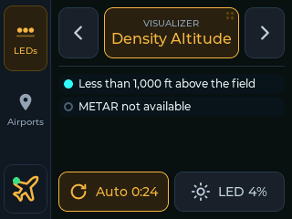
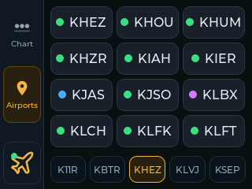
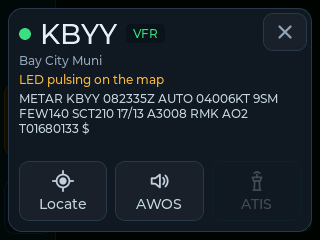
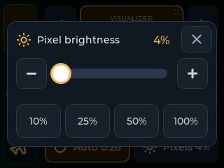
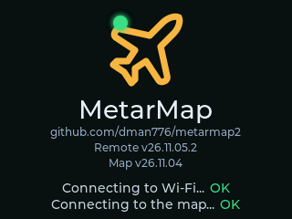
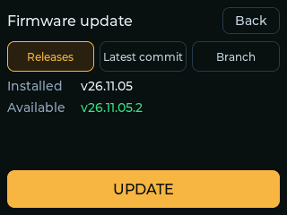

# MetarMap2 Remote

A touchscreen remote for a [MetarMap2](https://github.com/dman776/metarmap2)
map: firmware for a 2.8" ESP32-S3 touch display that sits beside the map and
works like a small version of the map's `/remote` page. Pick the visualizer,
see what the LEDs mean, set the LED brightness, turn auto-rotate on or off,
and find an airport's LED.

The map stays in charge. The remote reads the map's state over its HTTP API and
sends it the same controls the `/remote` page does; it never fetches weather or
drives LEDs itself.

| LEDs | Airports | An airport's card |
|---|---|---|
|  |  |  |
| **Brightness** | **Splash** | **Update** |
|  |  |  |

## What it does

Everything is a tap, with big targets and as little scrolling as possible. A rail down the left side has three
buttons: **LEDs**, **Airports**, and the **logo**.

**LEDs**

- The running visualizer, big, with ◀ and ▶ either side to step through them. It follows the map when something
  else changes the visualizer (auto-rotate, the web UI, Home Assistant).
- Tap the visualizer for the **picker**: every visualizer at once, a tile each with its icon and short name
  ("Density Alt"), the running one lit; tap one to switch the map to it, or **Close**. Rainbow and Chase, which
  take the whole strip, have a purple border.
- The legend, showing only the entries the map is showing now: if every
  airport is VFR, just VFR (plus lightning or missing reports, if any). It
  appears once the map has switched, never unfiltered.
- An entry a row, its whole label (a long one wraps onto a second line). When
  they don't all fit, the list glides slowly down to the last entry, rests 2 s,
  glides back up, rests, and so on. Scroll it with a finger to read it your own
  way; 10 s after you let go it starts gliding again from there.
- Along the bottom: **Auto** (auto-rotate on or off, lit while on, counting down
  to the next visualizer) and **LED**, the brightness, which opens a sheet: a
  slider, - and + (5% a press), and 10%, 25%, 50% and 100%.

**Airports**

- A tile for every airport, with its flight category's color, in alphabetical
  order, twelve to a page. Swipe left or right for the next or previous page, or
  tap the strip under the tiles: a button for each page, named for its first
  airport (with more pages than fit, ◀ "3 / 9" ▶).
- A tap on an airport pulses its LED white and opens its **card**: its code,
  flight category and name, its METAR, and three big buttons: **Locate** (pulse
  it again), **AWOS** (read its METAR aloud) and **ATIS** (its real ATIS, where it
  publishes one). While one plays its button is **Stop**. Closing the card (✕, or
  a tap beside it) stops it.
- A tile also flashes, on its page, when the map pulses it from anywhere.
- While Rainbow or Chase runs, the tiles are dimmed and the card says locating
  is paused.

**The logo**

- Its dot is the map's connection: green, or red while the map doesn't answer
  (and the screen dims). A yellow star on it: a firmware update.
- A tap shows the splash screen with the versions and the map's address, and two
  buttons: **Close**, and **Firmware** (**Update v...** when there's one), the
  firmware update screen. It closes on its own after 30 s.

**Web page**

- The remote serves its own page at **http://metarmap-remote.local/** (or its
  IP, which the logo's splash shows as "Settings: http://..."). Log in as
  **metar** with the password **map**, the same defaults as the map's own web
  UI, and change the password on the page (or set `WEB_PASSWORD` in
  `secrets.h`). The page says so while it's still `map`.
- **Screen**: the remote's screen as a PNG, refreshed on demand or live (about
  once a second), and **Download PNG**.
- **Firmware**: the installed and available versions, the update channel and
  branch, **Check now** and **Install**, with its progress.
- **Settings**: the Wi-Fi network and password, and the map's address and port;
  saving restarts the remote with them. If it can't join the new network, use
  **Wi-Fi setup** on its screen (below). A USB build's `secrets.h` applies only
  when it changes, so what you save on the page stays.
- **Log**: the last 32 KB of the remote's log (what the serial console shows,
  each line with the seconds since startup), following new lines as they come,
  and **Download**.
- Live control of the map stays on the touchscreen and the map's own pages.

**Wi-Fi setup**

- A remote that isn't set up yet (the published firmware, or a build without
  `secrets.h`) opens its own open Wi-Fi network, **MetarMap2-Remote-** and four
  letters from the board (e.g. `MetarMap2-Remote-8160`), and shows how to join
  it: the name, and a QR code a phone's camera scans to join.
- On the phone, the setup page opens by itself (a captive portal, like a hotel's
  Wi-Fi), or go to **http://192.168.4.1/**. Pick your Wi-Fi from the networks
  the remote can see (2.4 GHz only), or **Other network...** for a hidden one,
  enter its password, and the map's address (`metarmap.local` unless you gave
  the Pi another hostname) and port. **Save and connect** restarts the remote
  on your Wi-Fi. No login here: it's your phone on the remote's own network.
- A remote that was set up but can't join its Wi-Fi any more (a new router, a
  changed password) shows **Wi-Fi setup** on its splash once it says "Can't
  join" or "Can't find". The same network and page come up; meanwhile, while no
  phone is joined, it keeps trying the saved Wi-Fi and closes Wi-Fi setup if
  that comes back (a router restarting). **Cancel**, or 10 minutes with no
  phone, also closes it.

**Splash screen**

- At startup: the MetarMap2 logo, the metarmap2 repo, the remote's firmware
  version and the map's (once it answers: v26.11.04, or v26.11.04+16 f86daa4
  when the map runs commits after a release), and
  "Connecting to Wi-Fi..." and "Connecting to the map..." turning OK. Two
  seconds after both are OK, the remote fades in.
- If Wi-Fi hasn't joined after 15 s, it names the network: "Can't find
  *network*" (out of range, or 5 GHz only) or "Can't join *network*", and keeps
  trying. The map's line says "retrying" while the map doesn't answer.
- If the map stops answering (or Wi-Fi drops) for 5 s, the remote goes back to it:
  "Reconnecting to the map... retrying" until the map answers, then the remote fades
  back in. Not while the update screen is open.

**Firmware updates**

- The remote checks GitHub for new firmware at startup and every 6 hours. When
  there is some, a yellow star appears on the logo.
- The logo's splash screen has **Update v...** (or **Firmware**) for the update
  screen: the installed and available versions, the update channel, and
  **UPDATE**, which downloads the new firmware, checks it, installs it and
  restarts.
- The channels are metarmap2's: **Releases** (the newest release, if newer than
  the installed one), **Latest commit** (the newest commit of `main`) and
  **Branch** (the newest commit of the branch you pick). The choice is saved.

**Volume**

- While the speaker plays, the airport's card has a volume slider above its
  buttons: heard at once, and kept through restarts. It hides when the audio
  stops.

**Spoken weather**

- **AWOS** on an airport's card reads its METAR through the speaker, as an AWOS
  reads it. It plays once, the card saying "Getting the
  AWOS..." and then "Playing the AWOS".
- AWOS and ATIS work only while the map can speak (`/api/live`'s `speech`); with
  speech off at the map, or no server set, they're dimmed. They follow the map
  within a couple of seconds of the switch.
- The words come from the map: metarmap2 newer than 26.11.07, with **Enable
  speech** on in its **Config > System > Spoken weather** and a speech server
  set there (Piper in Home Assistant, or Kokoro). The remote plays the map's
  `/api/speak/<code>.audio`, a WAV, as it is (no decoding), resampled to
  16 kHz. The map makes the clip before answering, so the first time can take
  a few seconds; it keeps it until the next METAR.
- If the map can't, the remote shows why, in the map's words (e.g. spoken
  weather is off, or the speech server can't be reached).
- Always from the remote's map (`MAP_HOST`).

**Spoken ATIS**

- With **Spoken ATIS** on at the map (Config > System > Spoken weather), the
  card's **ATIS** reads an airport's ATIS aloud where it publishes a digital one
  (about 75 large US airports; dimmed for the others): the information letter,
  the runways and approaches in use, the NOTAMs.
- **Read along**: once the sound starts, the card's METAR gives way to the ATIS
  line by line, the FAA's text over how it's said, with the line being said
  lit and kept in view. The map sends the lines (`/api/atis/<code>/lines`); the
  remote knows how far into the audio it is from the WAV's length, so the
  highlight follows the voice closely. Tap the text to stop; after the end it
  stays to read, and a tap goes back to the METAR.
- The map makes the whole ATIS before answering, about half a minute on a
  Kokoro server, so "Getting the ATIS..." shows until it starts; the remote
  waits up to 2 minutes. After that it's kept until the ATIS changes.
- Needs metarmap2 with spoken ATIS (after 26.11.07). How a word is said is set
  on the map's Pronunciation page.

**Everywhere**

- A short tick from the speaker on each touch.
- A touch has to move 16 px before it scrolls rather than taps, so a finger
  that drifts a little still taps.
- Like the `/remote` page, a control you just touched keeps your setting for
  3 s while the map catches up.
- The visualizers' icons and short names come from the map (metarmap2 after
  26.11.08); with an older map the picker shows each visualizer's name, without
  an icon.

The `/remote` page's Map tab (the live map needs a browser), the visualizer's
description and the OLED switch are left out.

## Hardware

An LCDwiki **ES3C28P** ([wiki](https://www.lcdwiki.com/2.8inch_ESP32-S3_Display)):

- ESP32-S3 (N16R8): 16 MB flash, 8 MB PSRAM, Wi-Fi (2.4 GHz only)
- 2.8" ILI9341V 320×240 LCD, used in landscape with the USB-C port on the right
- FT6336G capacitive touch
- ES8311 audio codec and FM8002E amplifier, for a small speaker (up to 2 W
  into 4 Ω, per the wiki) on the 2-pin 1.25 mm speaker socket. It's optional:
  without one the remote is just silent

Power it from USB-C. The pin map is in
[include/board_es3c28p.h](include/board_es3c28p.h).

### Bezel

A bezel you can print on your own 3D printer holds the screen in your map:
[bezel/Metarmap Remote es3c28p_bezel_and_frame.3mf](bezel/Metarmap%20Remote%20es3c28p_bezel_and_frame.3mf)
for the ES3C28P. It's a Bambu Studio / OrcaSlicer project with two parts, a
black bezel and a yellow logo, so it prints in two colors (or in one, if you
leave the logo out). The project is sliced for a Flashforge AD5X with 0.2 mm
layers, 4 walls and 15% infill; pick your own printer and filament in the
slicer and slice it again.

## Setup

You need [PlatformIO](https://platformio.org/) (the VS Code extension or
`pip install platformio`) and a MetarMap2 map on your network.

1. Optional: copy `include/secrets.example.h` to `include/secrets.h` and fill
   it in: your Wi-Fi network and password, and the map's address and port
   (`metarmap.local` or its IP; port `80` unless you changed
   `web_server.port`). `secrets.h` is git-ignored. The remote saves these in
   its flash the first time it starts with them, so they stay through firmware
   updates, which don't have them. Without `secrets.h`, the remote starts in
   **Wi-Fi setup** (above) and you set it up from your phone.
2. Connect the board by USB-C. It shows up as a serial port
   (`/dev/cu.usbmodem*` on macOS); no driver is needed.
3. Build and flash:

   ```sh
   pio run -t upload
   pio device monitor        # optional: the serial console
   ```

If the upload can't find the board, hold **BOOT**, tap **RESET**, release
**BOOT**, and upload again.

## Network and security

The remote only uses the map's endpoints that need no login: `/api/live`,
`/api/status`, `/visualizer/...`, `/brightness/...` and `/locate/...`. It
doesn't know the map's username and password and can't change its saved
configuration (auto-rotate is the one setting those endpoints save).

Keep the map and the remote on a trusted local network, and don't expose the
map's web server to the internet. The Wi-Fi password is stored in the board's
flash, so treat the board like any device that knows it.

Firmware updates come only from this repo's GitHub releases, over HTTPS: the
remote trusts just the root certificates GitHub's API and downloads use
(`src/github_roots.h`), and checks each download against the SHA-256 GitHub
gives for it before switching to it. The published firmware has no Wi-Fi
settings in it.

The Wi-Fi setup network is open and its page has no login, as anyone setting it
up has to be at the remote: it comes up only on a remote that isn't set up yet,
or from a tap on the remote's own screen, and closes after 10 minutes with
nobody joined.

## How it works

A background task on the ESP32's second core polls `/api/live` every 1.5 s
and `/api/status` every minute, and again whenever the visualizer changes (for
its legend), the same split the `/remote` page uses. The touch screen runs on
the other core, so a slow answer never freezes it. Controls are queued to the
background task and the next `/api/live` shows their result.

Firmware updates use the board's two firmware slots: the new firmware goes
into the spare one while the running one carries on, and the board switches
only after the whole file has arrived and matched its checksum. A failed or
interrupted download leaves the running firmware as it was. (The board's
bootloader can't roll back on its own, so if new firmware didn't start at all,
flash it by USB.)

Which legend entries are in use comes from the map: `/api/live`'s
`visualizer.legendInUse` names them by the `key` each entry has in
`/api/status`. The map knows exactly what each LED shows (an estimated MVFR is
MVFR and Estimated; light snow is Snow and Light). The remote always filters,
whatever the map's own "Only show legend items in use" setting is.

A map from before `legendInUse` doesn't say, so the remote works it out from
each LED's current look in `/api/live`: its effect and color (so blinking red
isn't solid red), a color along a gradient entry (temperature, pressure), the
lightning flag for the flash entry, else the nearest entry with the same
effect.

See the [MetarMap2 API documentation](https://github.com/dman776/metarmap2/blob/master/API.md)
for the endpoints.

| File | What it does |
|---|---|
| `src/main.cpp` | Setup, Wi-Fi, the main loop, serial commands |
| `src/remote_web.cpp`, `src/remote_web_page.h` | The remote's own web page: settings, firmware, the log, screenshots |
| `src/log.cpp`, `src/log_ring.cpp` | Logging to serial and the last 32 KB kept for the web page |
| `src/png.cpp` | Screenshots as PNG (compressed by the ESP32-S3 ROM's deflate on the board) |
| `src/wifi_setup.cpp`, `src/remote_setup_page.h` | Wi-Fi setup: the remote's own network, the captive portal, the setup page |
| `src/wifi_setup_text.cpp` | Wi-Fi setup's network name, QR code text and network list |
| `src/ui.cpp` | The screens (LVGL) |
| `src/map_client.cpp` | Polling the map and sending controls, on its own task |
| `src/map_parse.cpp` | The API's JSON into `MapLive` and `MapStatus` |
| `src/legend.cpp` | Which legend entries the map is showing |
| `src/pages.cpp` | The Airports panel's pages: alphabetical order, the page strip |
| `src/map_state.h` | The map's state as the remote knows it |
| `src/lvgl_port.cpp` | Display and touch for LVGL, screenshots |
| `src/audio.cpp` | The codec, the touch tick and the I2S output |
| `src/stream.cpp` | The speaker's player: the spoken weather from the map, on two tasks |
| `src/stream_dsp.cpp` | The player's ring buffer, resampler and URL parsing |
| `src/third_party/minimp3.h` | The MP3 decoder (public domain); one marked change: its scratch can live in PSRAM |
| `src/updater.cpp` | Checking GitHub and installing firmware, on its own task |
| `src/update_check.cpp` | GitHub's release JSON, versions, what's an update |
| `src/settings.cpp` | Wi-Fi, map and update settings, in flash |
| `src/display.h` | Display and touch driver settings (LovyanGFX) |
| `src/logo.c`, `src/star_icon.c`, `src/icons.c` | Images, generated from `assets/*.svg` and `assets/icons/*.svg` |
| `src/github_roots.h` | The certificates trusted for GitHub, generated |
| `include/lv_conf.h` | LVGL settings and fonts |

## Development

The firmware uses the Arduino framework with [LVGL](https://lvgl.io/) 9,
[LovyanGFX](https://github.com/lovyan03/LovyanGFX) and
[ArduinoJson](https://arduinojson.org/) 7.

### Tests and lint

The parsing, legend, paging, update-check and audio (buffer, resampler, URL) code is plain C++ with unit tests that
run on your computer (PlatformIO's Unity framework). The JSON fixtures in
`test/test_parse` are real, trimmed answers from a map.

```sh
pio test -e native         # unit tests
pio check                  # static analysis (cppcheck)
pre-commit install         # once: clang-format and ruff on every commit
pre-commit run -a          # or run them on everything now
```

C++ is formatted by clang-format (Google style, 120 columns) and the Python
tools by ruff. GitHub Actions runs all of these and builds the firmware on
every push and pull request.

### Version

The splash screen's version comes from `git describe` at build time
(`tools/version.py`). Releases are named like metarmap2's, by the date they're
made: `vYY.MM.DD` (`v26.11.07`), with `.1`, `.2`... for another release the same
day (`v26.11.07.1`).

| Build | Shows |
|---|---|
| At a release tag | `v26.11.05` |
| Commits after it | `v26.11.05+3 abc1234` |
| Before the first tag | `abc1234` |
| With uncommitted changes | `... modified` |

### Publishing firmware

`.github/workflows/publish.yml` builds the firmware for the update channels:

- Push a release tag named for today (`git tag v26.11.07 && git push origin v26.11.07`): it
  creates the GitHub release, if there isn't one, and attaches
  `metarmap_remote-es3c28p.bin`. That's the **Releases** channel.
- Each push to a branch replaces a pre-release tagged `build-<branch>` with that
  commit's firmware: `build-main` is **Latest commit**, the others are
  **Branch**. Deleting a branch removes its build.

A push or pull request that changes only the README and `docs/` doesn't run the
checks or build firmware. Tag pushes always do.

### Serial console and screenshots

At 115200 baud the console logs the version, the connection and each control
sent, and the update checks. It also takes one-letter commands: `1` and `2`
open the LEDs and Airports panels, `3` shows the splash screen, `4` the
update screen, `5` the visualizer picker, `6` the brightness sheet, `7` the
card of the Airports page's first airport, `H` logs the free memory, `W` starts Wi-Fi setup, and `S` sends a screenshot, which
`tools/screenshot.py` saves as a PNG (it needs pyserial):

```sh
python3 tools/screenshot.py /dev/cu.usbmodem* screen.png      # as it is
python3 tools/screenshot.py /dev/cu.usbmodem* airports.png 2  # Airports first
```

### Generated files

- `src/logo.c` and `src/star_icon.c` come from `assets/logo.svg` (the map's
  header logo) and `assets/star.svg`, and `src/icons.c` and `src/icons.h` from
  `assets/icons/` (white, so the screens can color them; `vis_<name>.svg` are
  the visualizers' icons, by the name the map sends): `python3
  tools/make_images.py`, which needs `rsvg-convert` (`brew install librsvg`).
- `src/github_roots.h` comes from Mozilla's root certificate list:
  `python3 tools/make_ca.py`. Run it again if update checks start failing with
  a certificate error.
