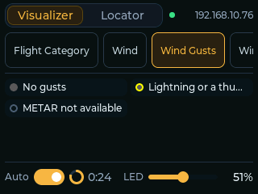
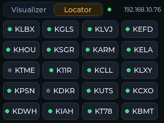

# METARMap Remote

A touchscreen remote for a [METARMap2](https://github.com/dman776/metarmap2)
map: firmware for a 2.8" ESP32-S3 touch display that sits beside the map and
works like a small version of the map's `/remote` page. Pick the visualizer,
see what the LEDs mean, set the LED brightness, turn auto-rotate on or off,
and find an airport's LED.

The map stays in charge. The remote reads the map's state over its HTTP API and
sends it the same controls the `/remote` page does; it never fetches weather or
drives LEDs itself.

| Visualizer | Locator | Splash |
|---|---|---|
|  |  |  |

## What it does

**Visualizer tab**

- A chip for every visualizer, the running one lit. Swipe the row to find one
  and tap it to switch the map to it; the row follows the map when something
  else changes the visualizer (auto-rotate, the web UI, Home Assistant).
- The legend, showing only the entries the map is showing now: if every
  airport is VFR, just VFR (plus lightning or missing reports, if any). It
  appears once the map has switched, never unfiltered.
- Along the bottom: **Auto** (auto-rotate on or off, with a ring counting down
  to the next visualizer) and **LED** brightness.

**Locator tab**

- A tile for every airport, with its flight category's color. Tap one to pulse
  its LED white; a tile also flashes when the map pulses it from anywhere.
- While Rainbow or Chase runs, a banner says locating is paused.

**Splash screen**

- At startup: the MetarMap logo, the metarmap2 repo, the firmware version, and
  "Connecting to Wi-Fi..." and "Connecting to the map..." turning OK. Two
  seconds after both are OK, the remote fades in.
- If Wi-Fi hasn't joined after 15 s, it names the network: "Can't find
  *network*" (out of range, or 5 GHz only) or "Can't join *network*", and keeps
  trying. The map's line says "retrying" while the map doesn't answer.
- Touch and hold the screen for 5 s to see it again for 5 s.

**Firmware updates**

- The remote checks GitHub for new firmware at startup and every 6 hours. When
  there is some, a yellow star appears in the top bar, left of the map's dot.
- Keep holding a touch past the splash screen, to 10 s, for the update screen:
  the installed and available versions, the update channel, and **UPDATE**,
  which downloads the new firmware, checks it, installs it and restarts.
- The channels are metarmap2's: **Releases** (the newest release, if newer than
  the installed one), **Latest commit** (the newest commit of `main`) and
  **Branch** (the newest commit of the branch you pick). The choice is saved.

**Everywhere**

- A short tick from the speaker on each touch.
- The map's address, top right, with a green dot; "can't reach the map" and a
  dimmed screen while it doesn't answer. A yellow star beside it: a firmware
  update.
- Like the `/remote` page, a control you just touched keeps your setting for
  3 s while the map catches up.

The `/remote` page's Map tab (the live map needs a browser), the visualizer's
description, the previous/next buttons and the OLED switch are left out.

## Hardware

An LCDwiki **ES3C28P** ([wiki](https://www.lcdwiki.com/2.8inch_ESP32-S3_Display)):

- ESP32-S3 (N16R8): 16 MB flash, 8 MB PSRAM, Wi-Fi (2.4 GHz only)
- 2.8" ILI9341V 320×240 LCD, used in landscape with the USB-C port on the right
- FT6336G capacitive touch
- ES8311 audio codec and FM8002E amplifier, for a small speaker (up to 2 W
  into 4 Ω, per the wiki) on the 2-pin 1.25 mm speaker socket. It's optional:
  without one the remote is just silent

Power it from USB-C. The pin map is in
[include/board_es3c28p.h](include/board_es3c28p.h).

## Setup

You need [PlatformIO](https://platformio.org/) (the VS Code extension or
`pip install platformio`) and a METARMap2 map on your network.

1. Copy `include/secrets.example.h` to `include/secrets.h` and fill it in:
   your Wi-Fi network and password, and the map's address and port
   (`metarmap.local` or its IP; port `80` unless you changed
   `web_server.port`). `secrets.h` is git-ignored. The remote saves these in
   its flash when it starts, so they stay through firmware updates, which
   don't have them; flash again with a changed `secrets.h` to change them.
2. Connect the board by USB-C. It shows up as a serial port
   (`/dev/cu.usbmodem*` on macOS); no driver is needed.
3. Build and flash:

   ```sh
   pio run -t upload
   pio device monitor        # optional: the serial console
   ```

If the upload can't find the board, hold **BOOT**, tap **RESET**, release
**BOOT**, and upload again.

## Network and security

The remote only uses the map's endpoints that need no login: `/api/live`,
`/api/status`, `/visualizer/...`, `/brightness/...` and `/locate/...`. It
doesn't know the map's username and password and can't change its saved
configuration (auto-rotate is the one setting those endpoints save).

Keep the map and the remote on a trusted local network, and don't expose the
map's web server to the internet. The Wi-Fi password is stored in the board's
flash, so treat the board like any device that knows it.

Firmware updates come only from this repo's GitHub releases, over HTTPS: the
remote trusts just the root certificates GitHub's API and downloads use
(`src/github_roots.h`), and checks each download against the SHA-256 GitHub
gives for it before switching to it. The published firmware has no Wi-Fi
settings in it.

## How it works

A background task on the ESP32's second core polls `/api/live` every 1.5 s
and `/api/status` every minute, and again whenever the visualizer changes (for
its legend), the same split the `/remote` page uses. The touch screen runs on
the other core, so a slow answer never freezes it. Controls are queued to the
background task and the next `/api/live` shows their result.

Firmware updates use the board's two firmware slots: the new firmware goes
into the spare one while the running one carries on, and the board switches
only after the whole file has arrived and matched its checksum. A failed or
interrupted download leaves the running firmware as it was. (The board's
bootloader can't roll back on its own, so if new firmware didn't start at all,
flash it by USB.)

The map doesn't say which legend entry each LED shows, so the remote works it
out from each LED's current look in `/api/live`: its effect and color (so
blinking red isn't solid red), a color along a gradient entry (temperature,
pressure), the lightning flag for the flash entry, else the nearest entry with
the same effect.

See the [METARMap2 API documentation](https://github.com/dman776/metarmap2/blob/master/API.md)
for the endpoints.

| File | What it does |
|---|---|
| `src/main.cpp` | Setup, Wi-Fi, the main loop, serial commands |
| `src/ui.cpp` | The screens (LVGL) |
| `src/map_client.cpp` | Polling the map and sending controls, on its own task |
| `src/map_parse.cpp` | The API's JSON into `MapLive` and `MapStatus` |
| `src/legend.cpp` | Which legend entries the map is showing |
| `src/map_state.h` | The map's state as the remote knows it |
| `src/lvgl_port.cpp` | Display and touch for LVGL, screenshots |
| `src/audio.cpp` | The codec and the touch tick |
| `src/updater.cpp` | Checking GitHub and installing firmware, on its own task |
| `src/update_check.cpp` | GitHub's release JSON, versions, what's an update |
| `src/settings.cpp` | Wi-Fi, map and update settings, in flash |
| `src/display.h` | Display and touch driver settings (LovyanGFX) |
| `src/logo.c`, `src/star_icon.c` | Images, generated from `assets/*.svg` |
| `src/github_roots.h` | The certificates trusted for GitHub, generated |
| `include/lv_conf.h` | LVGL settings and fonts |

## Development

The firmware uses the Arduino framework with [LVGL](https://lvgl.io/) 9,
[LovyanGFX](https://github.com/lovyan03/LovyanGFX) and
[ArduinoJson](https://arduinojson.org/) 7.

### Tests and lint

The parsing, legend and update-check code is plain C++ with unit tests that
run on your computer (PlatformIO's Unity framework). The JSON fixtures in
`test/test_parse` are real, trimmed answers from a map.

```sh
pio test -e native         # unit tests
pio check                  # static analysis (cppcheck)
pre-commit install         # once: clang-format and ruff on every commit
pre-commit run -a          # or run them on everything now
```

C++ is formatted by clang-format (Google style, 120 columns) and the Python
tools by ruff. GitHub Actions runs all of these and builds the firmware on
every push and pull request.

### Version

The splash screen's version comes from `git describe` at build time
(`tools/version.py`). Releases are named like metarmap2's, by the date they're
made: `vYY.MM.DD` (`v26.11.07`), with `.1`, `.2`... for another release the same
day (`v26.11.07.1`).

| Build | Shows |
|---|---|
| At a release tag | `v26.11.05` |
| Commits after it | `v26.11.05+3 abc1234` |
| Before the first tag | `abc1234` |
| With uncommitted changes | `... modified` |

### Publishing firmware

`.github/workflows/publish.yml` builds the firmware for the update channels:

- Push a release tag named for today (`git tag v26.11.07 && git push origin v26.11.07`): it
  creates the GitHub release, if there isn't one, and attaches
  `metarmap_remote-es3c28p.bin`. That's the **Releases** channel.
- Each push to a branch replaces a pre-release tagged `build-<branch>` with that
  commit's firmware: `build-main` is **Latest commit**, the others are
  **Branch**. Deleting a branch removes its build.

### Serial console and screenshots

At 115200 baud the console logs the version, the connection and each control
sent, and the update checks. It also takes one-letter commands: `1` and `2`
open the Visualizer and Locator tabs, `3` shows the splash screen, `4` the
update screen, and `S` sends a screenshot, which
`tools/screenshot.py` saves as a PNG (it needs pyserial):

```sh
python3 tools/screenshot.py /dev/cu.usbmodem* screen.png      # as it is
python3 tools/screenshot.py /dev/cu.usbmodem* locator.png 2   # Locator tab first
```

### Generated files

- `src/logo.c` and `src/star_icon.c` come from `assets/logo.svg` (the map's
  header logo) and `assets/star.svg`: `python3 tools/make_images.py`, which
  needs `rsvg-convert` (`brew install librsvg`).
- `src/github_roots.h` comes from Mozilla's root certificate list:
  `python3 tools/make_ca.py`. Run it again if update checks start failing with
  a certificate error.
